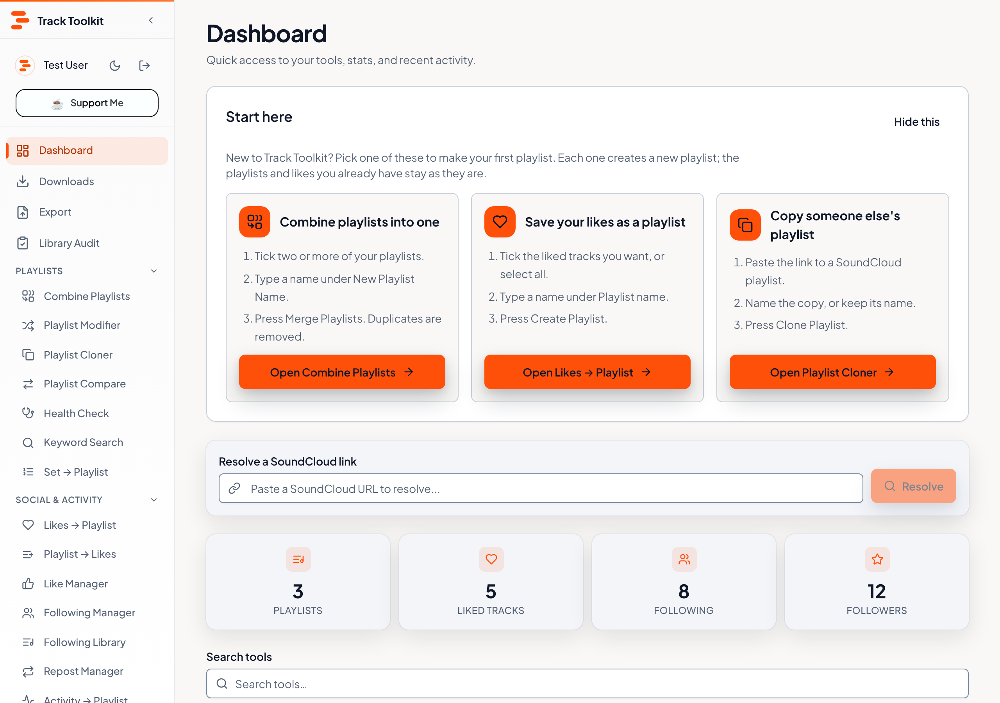
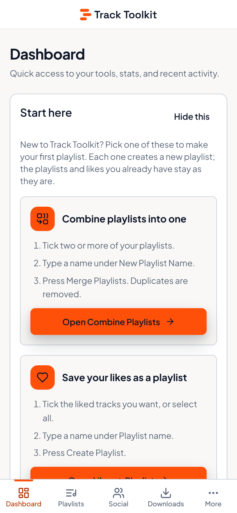
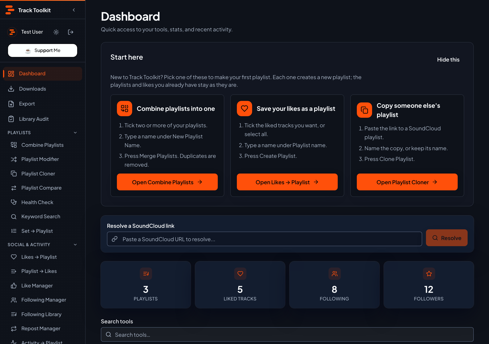
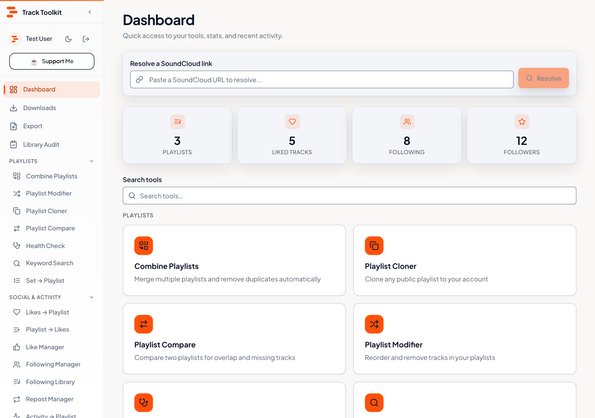
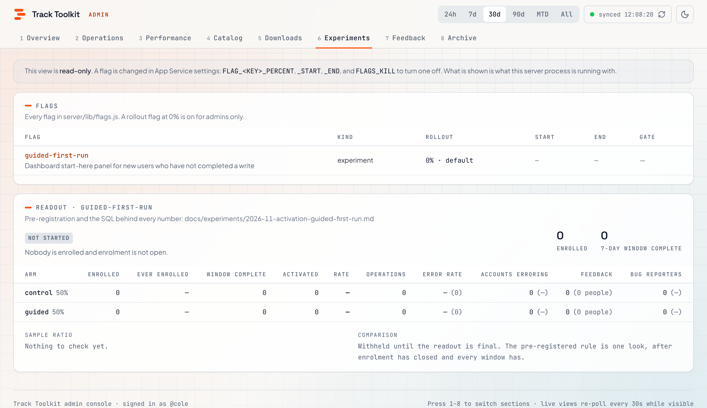

# Experiment 1: guided first run (activation of new users)

Pre-registration. Written 2026-11-23, before any data from this experiment
exists. Everything under "Fixed before launch" is decided now. The four
marked blanks are filled by Cole from the baseline query, before the percent
is raised, and are not changed after that.

- Flag key: `guided-first-run` (`server/lib/flags.js`)
- Status: built, off. The flag ships at 0%, so merging changes nothing.
- Readout: admin console → Experiments, or the `readout` query below. The two
  give the same numbers; `tests/routes/experiment-readout.integration.test.js`
  runs both against the same rows.

## 1. Hypothesis

A new user lands on a dashboard of 20 tools with no indication of where to
begin. Showing them three first jobs, each with the three steps it takes,
will raise the share who complete a write to their SoundCloud account in
their first week.

- H0: the 7-day activation rate is the same in both arms.
- H1: it differs (two-sided).

## 2. Variants

| Arm | Weight | What the user sees |
|---|---:|---|
| `control` | 50 | The dashboard as it is today. Nothing is added. |
| `guided` | 50 | The same dashboard with a "Start here" panel above it. |

The panel (`frontend-UI/src/components/FirstRunGuide.tsx`) lists three jobs:
Combine Playlists, Likes → Playlist and Playlist Cloner. Each has three
numbered steps that name the controls on the tool page, and a button that
opens the tool. All three create a new playlist by default, so the panel can
say that nothing already in the library is changed. "Hide this" removes it
for that browser. It disappears by itself once the account has completed a
write. Nothing else on the dashboard moves or is removed.






To see it on the live site without being enrolled: sign in as an admin and
open `/dashboard/?first-run=preview`. A preview records nothing.

## 3. Unit of assignment

The SoundCloud account (`users."soundcloudId"`), not the `users` row. The arm
is `sha256("guided-first-run:variant:<soundcloudId>")`, first 32 bits, modulo
100: under 50 is `control`, otherwise `guided`. It is the same on every
request, device and deploy. Someone who deletes their account and signs up
again gets the same arm.

## 4. Eligibility and exposure

An account is enrolled the first time all of these hold, at the moment its
dashboard is about to render (`resolveExposure` in
`server/lib/experiments.js`):

1. The flag is not killed and its percent is above 0.
2. The account is not on `ADMIN_IDS` (the owner and admins) or
   `EXPERIMENT_EXCLUDE_IDS`.
3. Its first login, `users."createdAt"`, is at or after
   `FLAG_GUIDED_FIRST_RUN_START` and before `FLAG_GUIDED_FIRST_RUN_END`.
4. Its rollout bucket is under the percent.
5. It is within 7 days of its first login.
6. It has no successful write yet. Someone who has would see the same
   dashboard in both arms, so they could not see a difference.

Enrolment writes one row to `experiment_exposures`, unique on (user,
experiment), and adds one to the arm's counter in `metrics`. A request that
cannot write the row gets control and is not enrolled, so nobody is shown the
panel without being recorded. Both arms are enrolled by the same request at
the same moment; only the response differs.

"First login" is `users."createdAt"`: the row is created by the first OAuth
callback and the repo has no other first-login column.

## 5. Primary metric

**Share of enrolled accounts with at least one successful write operation
within 7 days of first login.**

- Window: `[users."createdAt", users."createdAt" + 7 days)`.
- Successful: `operation_logs.status` in `success`, `split`, `partial`
  (`partial` means some items were written).
- Write: `operation_logs.action` in this list (`WRITE_ACTIONS` in
  `server/lib/experiments.js`; `tests/experiment-docs.test.js` fails if this
  document and the code differ):

  `merge`, `from-likes`, `clone`, `clone-user-likes`,
  `followed-likes-to-playlist`, `followed-playlist-clone`,
  `setlist-to-playlist`, `playlist-transfer`, `playlist-bulk-add-tracks`,
  `playlist-bulk-remove-tracks`, `delete-playlist`, `bulk-like`,
  `bulk-unlike`, `bulk-unfollow`, `bulk-remove-reposts`,
  `growth-engage-start`, `growth-reverse`, `sort-likes-apply`,
  `sort-likes-unlike`

- Denominator: enrolled accounts whose 7-day window has closed. At the
  analysis date that is every enrolled account that still exists.

## 6. Guardrails

Measured over each enrolled account's same 7-day window.

| Guardrail | Shown in the readout | Tested as |
|---|---|---|
| Operation error rate | failed operations / tool operations, per arm | share of enrolled accounts with at least one failed operation |
| Feedback submissions | feedback rows and the accounts behind them, per arm | share of enrolled accounts that sent at least one `bug` report |

A tool operation is any `operation_logs` row except `view:*` (page opens),
`read:*` (latency probes) and `auth-*`. Feedback marked `spam` is excluded.
The test is on accounts, not operations, because one account's operations
are not independent of each other. A guardrail is breached when the guided
arm's share is higher than control's with a two-sided p below 0.10.

These guardrails can only catch a large problem. The sample is sized for the
primary metric, so a guardrail that does not trip is not evidence of no harm.

## 7. Fixed before launch

| | |
|---|---|
| Test | Two-proportion z-test, two-sided, pooled standard error |
| Significance level (alpha) | 0.05 |
| Power | 0.80 |
| Split | 50 / 50 |
| Rollout percent during the run | 100 (of eligible new accounts) |
| Looks at the primary metric | One, at the analysis date |

Filled in by Cole, once, before raising the percent:

| | Value | Source |
|---|---|---|
| Baseline 7-day activation rate (p1) | **`[ BLANK: baseline ]`** | `ALL` row of the `baseline` query |
| Minimum detectable effect, absolute (MDE) | **`[ BLANK: mde ]`** | Cole's decision: the smallest lift that would be worth keeping the panel for |
| Sample size per arm (n) | **`[ BLANK: n per arm ]`** | formula in section 9 |
| Eligible new accounts per day | **`[ BLANK: arrivals per day ]`** | `ALL` row of the `baseline` query |
| Duration, days | **`[ BLANK: duration ]`** | section 9 |
| `FLAG_GUIDED_FIRST_RUN_START` | **`[ BLANK: start ]`** | chosen at launch |
| `FLAG_GUIDED_FIRST_RUN_END` | **`[ BLANK: end ]`** | start + duration |
| Analysis date | **`[ BLANK: end + 7 days ]`** | |

## 8. Baseline query

Read-only. It reports, for accounts first seen in the last 8 complete weeks
whose 7-day window has already closed, how many activated. The `ALL` row is
the baseline; `per_day` on that row is the arrival rate.

Run every query in this document in a session that cannot write:

```bash
docker run --rm -it -e PGOPTIONS="-c default_transaction_read_only=on" postgres:17 psql "$AZURE_PROD"
```

```sql
-- name: baseline
WITH bounds AS (
  SELECT (now() AT TIME ZONE 'UTC') - interval '7 days' AS until,
         (now() AT TIME ZONE 'UTC') - interval '7 days' - interval '56 days' AS since
),
cohort AS (
  SELECT u.id,
         u."createdAt" AS first_login,
         floor(extract(epoch FROM (b.until - u."createdAt")) / (7 * 86400))::int AS weeks_back,
         EXISTS (
           SELECT 1
           FROM operation_logs ol
           WHERE ol."userId" = u.id
             AND ol.action IN (
               'merge', 'from-likes', 'clone', 'clone-user-likes',
               'followed-likes-to-playlist', 'followed-playlist-clone',
               'setlist-to-playlist', 'playlist-transfer', 'playlist-bulk-add-tracks',
               'playlist-bulk-remove-tracks', 'delete-playlist', 'bulk-like',
               'bulk-unlike', 'bulk-unfollow', 'bulk-remove-reposts',
               'growth-engage-start', 'growth-reverse', 'sort-likes-apply',
               'sort-likes-unlike'
             )
             AND ol.status IN ('success', 'split', 'partial')
             AND ol."createdAt" >= u."createdAt"
             AND ol."createdAt" < u."createdAt" + interval '7 days'
         ) AS activated
  FROM users u
  CROSS JOIN bounds b
  WHERE u."createdAt" >= b.since
    AND u."createdAt" < b.until
)
SELECT CASE WHEN GROUPING(weeks_back) = 1 THEN 'ALL' ELSE weeks_back::text END AS weeks_back,
       COUNT(*)::int AS new_accounts,
       COUNT(*) FILTER (WHERE activated)::int AS activated,
       ROUND(COUNT(*) FILTER (WHERE activated)::numeric / NULLIF(COUNT(*), 0), 4) AS activation_rate,
       ROUND(COUNT(*)::numeric / CASE WHEN GROUPING(weeks_back) = 1 THEN 56 ELSE 7 END, 2) AS per_day
FROM cohort
GROUP BY ROLLUP (weeks_back)
ORDER BY GROUPING(weeks_back), weeks_back;
```

`weeks_back` 0 is the most recent complete week. Read the weekly rows before
the total: if the rate moves a lot from week to week, the baseline is not
stable and the sample size from it is a rough guide.

What this number is not:

- It counts accounts that still exist. Accounts deleted since (the 6-day
  disconnect sweep, account deletion) are gone with their operations, and
  they are more likely to be accounts that never ran anything, so the rate
  here is somewhat higher than the true one.
- It includes every new account, where the experiment only enrols those that
  reach the dashboard without a write. The difference should be small.
- Saves from Playlist Modifier and Health Check (`PUT /api/playlists/:id`)
  log nothing, so those writes are not counted, here or in the experiment.

## 9. Sample size and duration

Per arm, for a two-sided test at alpha with the stated power, baseline `p1`
and absolute effect `MDE`:

```
p2   = p1 + MDE
pbar = (p1 + p2) / 2

n = ( z[1 - alpha/2] * sqrt(2 * pbar * (1 - pbar))
    + z[power]       * sqrt(p1 * (1 - p1) + p2 * (1 - p2)) )^2
    / MDE^2
```

With alpha 0.05 and power 0.80, `z[1 - alpha/2]` is 1.959964 and `z[power]`
is 0.841621. Round `n` up. The same formula is `sampleSizePerArm` in
`server/lib/experiment-stats.js`; from the repo root, with the two blanks
substituted as decimals (a 5-point lift is `0.05`):

```bash
node -e "import('./server/lib/experiment-stats.js').then(m => console.log(m.sampleSizePerArm(BASELINE, MDE)))"
```

Duration, in days:

```
days = 2 * n / arrivals_per_day
```

Round up to whole weeks, so every weekday is in the run equally often, and
never run less than two weeks. `END` is `START` plus that. The analysis date
is `END` plus 7 days, when the last account's window closes.

If the duration this gives is longer than Cole is willing to run, the choice
is a larger MDE, made now and written in the table. It is not a shorter run
at the same MDE.

## 10. Stop rule

Fixed horizon. Enrolment runs from `START` to `END`. The primary metric is
looked at once, on the analysis date.

- No decision is made from the rates before then. The console shows counts
  and guardrails during the run and withholds the comparison until every
  window has closed.
- The run is stopped early only for harm: a guardrail far out of line, or a
  bug in the panel. Stop with `FLAGS_KILL=guided-first-run`. An experiment
  stopped early is reported as stopped, with its estimate and interval, and
  is not a result.
- If fewer than `n` accounts per arm are enrolled at `END`, `END` may be
  moved later once, using only the enrolment counts. Record the change here
  with its date. The outcome columns are not consulted for this.
- Do not change the percent, the split or the flag key during the run. Each
  restart logs `[flags] guided-first-run: …`; those lines are the record that
  the settings held.

## 11. Readout query

One row per arm. These are the numbers the console shows.

```sql
-- name: readout
WITH enrolled AS (
  SELECT e."userId" AS user_id,
         e.variant,
         u."createdAt" AS first_login,
         u."createdAt" + interval '7 days' AS window_end
  FROM experiment_exposures e
  JOIN users u ON u.id = e."userId"
  WHERE e."experimentKey" = 'guided-first-run'
),
ops AS (
  SELECT en.user_id,
         COUNT(*) AS operations,
         COUNT(*) FILTER (WHERE ol.status = 'error') AS errors,
         COUNT(*) FILTER (
           WHERE ol.action IN (
                   'merge', 'from-likes', 'clone', 'clone-user-likes',
                   'followed-likes-to-playlist', 'followed-playlist-clone',
                   'setlist-to-playlist', 'playlist-transfer', 'playlist-bulk-add-tracks',
                   'playlist-bulk-remove-tracks', 'delete-playlist', 'bulk-like',
                   'bulk-unlike', 'bulk-unfollow', 'bulk-remove-reposts',
                   'growth-engage-start', 'growth-reverse', 'sort-likes-apply',
                   'sort-likes-unlike'
                 )
             AND ol.status IN ('success', 'split', 'partial')
         ) AS writes
  FROM enrolled en
  JOIN operation_logs ol
    ON ol."userId" = en.user_id
   AND ol."createdAt" >= en.first_login
   AND ol."createdAt" < en.window_end
  WHERE ol.action NOT LIKE 'view:%'
    AND ol.action NOT LIKE 'read:%'
    AND ol.action NOT LIKE 'auth-%'
  GROUP BY en.user_id
),
fb AS (
  SELECT en.user_id,
         COUNT(*) AS submissions,
         COUNT(*) FILTER (WHERE f.type = 'bug') AS bugs
  FROM enrolled en
  JOIN feedback f
    ON f."userId" = en.user_id
   AND f."createdAt" >= en.first_login
   AND f."createdAt" < en.window_end
  WHERE f.status <> 'spam'
  GROUP BY en.user_id
),
ever AS (
  SELECT split_part(key, ':', 3) AS variant, value::int AS enrolled_ever
  FROM metrics
  WHERE key LIKE 'experiment\_enrolled:guided-first-run:%'
)
SELECT en.variant,
       COUNT(*)::int AS enrolled,
       MAX(ever.enrolled_ever) AS enrolled_ever,
       COUNT(*) FILTER (WHERE en.window_end <= (now() AT TIME ZONE 'UTC'))::int AS window_complete,
       COUNT(*) FILTER (
         WHERE en.window_end <= (now() AT TIME ZONE 'UTC') AND COALESCE(ops.writes, 0) > 0
       )::int AS activated,
       COALESCE(SUM(ops.operations), 0)::int AS operations,
       COALESCE(SUM(ops.errors), 0)::int AS operation_errors,
       COUNT(*) FILTER (WHERE COALESCE(ops.errors, 0) > 0)::int AS users_with_error,
       COALESCE(SUM(fb.submissions), 0)::int AS feedback_submissions,
       COUNT(*) FILTER (WHERE COALESCE(fb.submissions, 0) > 0)::int AS feedback_users,
       COUNT(*) FILTER (WHERE COALESCE(fb.bugs, 0) > 0)::int AS bug_feedback_users
FROM enrolled en
LEFT JOIN ops ON ops.user_id = en.user_id
LEFT JOIN fb ON fb.user_id = en.user_id
LEFT JOIN ever ON ever.variant = en.variant
GROUP BY en.variant
ORDER BY en.variant;
```

The console's view of the same numbers, as shipped (nothing enrolled):



`enrolled_ever` is the arm's counter. It includes accounts deleted since they
were enrolled; `enrolled` does not. An arm with no exposures has no row.

## 12. Analysis query

Run once, on the analysis date. It needs PostgreSQL 16 or later for `erfc`
(production is 17). `windows_still_open` must be 0; if it is not, it is not
the analysis date yet.

```sql
-- name: analysis
WITH enrolled AS (
  SELECT e."userId" AS user_id,
         e.variant,
         u."createdAt" AS first_login,
         u."createdAt" + interval '7 days' AS window_end
  FROM experiment_exposures e
  JOIN users u ON u.id = e."userId"
  WHERE e."experimentKey" = 'guided-first-run'
),
scored AS (
  SELECT en.variant,
         en.window_end <= (now() AT TIME ZONE 'UTC') AS complete,
         EXISTS (
           SELECT 1
           FROM operation_logs ol
           WHERE ol."userId" = en.user_id
             AND ol.action IN (
               'merge', 'from-likes', 'clone', 'clone-user-likes',
               'followed-likes-to-playlist', 'followed-playlist-clone',
               'setlist-to-playlist', 'playlist-transfer', 'playlist-bulk-add-tracks',
               'playlist-bulk-remove-tracks', 'delete-playlist', 'bulk-like',
               'bulk-unlike', 'bulk-unfollow', 'bulk-remove-reposts',
               'growth-engage-start', 'growth-reverse', 'sort-likes-apply',
               'sort-likes-unlike'
             )
             AND ol.status IN ('success', 'split', 'partial')
             AND ol."createdAt" >= en.first_login
             AND ol."createdAt" < en.window_end
         ) AS activated
  FROM enrolled en
),
arms AS (
  SELECT COUNT(*) FILTER (WHERE variant = 'control' AND complete)::float8 AS n1,
         COUNT(*) FILTER (WHERE variant = 'control' AND complete AND activated)::float8 AS x1,
         COUNT(*) FILTER (WHERE variant = 'guided' AND complete)::float8 AS n2,
         COUNT(*) FILTER (WHERE variant = 'guided' AND complete AND activated)::float8 AS x2,
         COUNT(*) FILTER (WHERE NOT complete)::int AS windows_still_open
  FROM scored
),
rates AS (
  SELECT *,
         x1 / NULLIF(n1, 0) AS p1,
         x2 / NULLIF(n2, 0) AS p2,
         (x1 + x2) / NULLIF(n1 + n2, 0) AS pooled
  FROM arms
),
test AS (
  SELECT *,
         (p2 - p1) / NULLIF(sqrt(pooled * (1 - pooled) * (1 / NULLIF(n1, 0) + 1 / NULLIF(n2, 0))), 0) AS z,
         1.959963984540054 * sqrt(p1 * (1 - p1) / NULLIF(n1, 0) + p2 * (1 - p2) / NULLIF(n2, 0)) AS margin
  FROM rates
)
SELECT windows_still_open,
       n1::int AS control_n,
       x1::int AS control_activated,
       p1 AS control_rate,
       n2::int AS guided_n,
       x2::int AS guided_activated,
       p2 AS guided_rate,
       p2 - p1 AS difference,
       p2 - p1 - margin AS ci95_low,
       p2 - p1 + margin AS ci95_high,
       z,
       erfc(abs(z) / sqrt(2.0)) AS p_value
FROM test;
```

For a guardrail, the same test applies with `n` as the arm's `enrolled` and
`x` as its `users_with_error` or `bug_feedback_users` from the readout.

## 13. Validity checks

Run before reading the result. Any failure makes the comparison untrustworthy
until it is explained.

1. **Sample ratio.** The console shows a chi-square test of the two arms'
   sizes against 50/50. A p-value below 0.001 means assignment or exposure
   logging is broken. Do not compare the arms.
2. **Assignment audit.** Recomputes each account's arm from its SoundCloud id
   in SQL and compares it to what was recorded. Every row must have
   `recorded = recomputed`:

   ```sql
   -- name: assignment-audit
   SELECT e.variant AS recorded,
          CASE
            WHEN ('x' || substr(encode(sha256(convert_to(
                   'guided-first-run:variant:' || u."soundcloudId", 'UTF8')), 'hex'), 1, 8)
                 )::bit(32)::bigint % 100 < 50
            THEN 'control' ELSE 'guided'
          END AS recomputed,
          COUNT(*)::int AS accounts
   FROM experiment_exposures e
   JOIN users u ON u.id = e."userId"
   WHERE e."experimentKey" = 'guided-first-run'
   GROUP BY 1, 2
   ORDER BY 1, 2;
   ```

3. **Deleted accounts.** `enrolled_ever - enrolled` is how many enrolled
   accounts each arm has lost. They cannot be scored, because their
   operations went with them. If the two arms lost clearly different shares,
   also report the conservative figure, `activated / enrolled_ever` per arm
   (every deleted account counted as not activated), and say which the
   conclusion rests on.
4. **Settings held.** The `[flags] guided-first-run` boot lines show the same
   percent, start and end for the whole run, and no `KILLED`.

## 14. Decision rule

Decided on the analysis date from the `analysis` query, after section 13
passes and with at least `n` accounts per arm.

| Result | Decision |
|---|---|
| `p_value` < 0.05, `difference` > 0, no guardrail breached | Keep the panel: make it the default for new accounts, then delete the flag. |
| `p_value` < 0.05, `difference` > 0, a guardrail breached | Do not ship as it is. Find the cause of the errors or bug reports first. |
| `p_value` < 0.05, `difference` < 0 | The panel hurt activation. Remove it. |
| `p_value` >= 0.05 | No effect of the pre-registered size was detected. Remove the panel. Report the estimate and its 95% interval; do not describe it as "no effect". |
| Fewer than `n` per arm, after the one extension | Inconclusive. Report the estimate and interval as they are. |

Whatever the result, it is written up with: the baseline, MDE and `n` from
section 7, the enrolled and activated counts per arm, the difference with its
interval, the p-value, the guardrails, and anything in section 13 that did
not pass.

## 15. Known limits

- Writes through `PUT /api/playlists/:id` are not logged, so an account whose
  only write in its first week is a Playlist Modifier or Health Check save
  counts as not activated. This affects both arms.
- The exposure is recorded when the server answers. If the answer is lost on
  the way to the page, a guided account sees control on that load and is
  still counted as guided. This can only make the measured effect smaller.
- A person with two SoundCloud accounts can be in both arms.
- "Hide this" removes the panel for a browser; the account stays in the
  guided arm.
- A new account also sees the one-time rebrand notice over its first
  dashboard, in both arms.
- The settings live on the App Service and `infra/deploy.sh` removes them
  (`docs/internal/STATE.md`, Landmines). Do not run an infra deploy during
  the run; if one is unavoidable, restore the three settings immediately and
  note the gap here.

## 16. Launch checklist

1. Apply `docs/sql/2026-11-experiment-exposures.sql` to Azure Postgres. Then
   merge. The server refuses to start without the table.
2. Confirm the deploy: admin console → Experiments shows `guided-first-run`
   at `0% · default`, "Not started".
3. Look at the panel at `/dashboard/?first-run=preview` at your own window
   width and at 1280. Change it now if it should change.
4. Run the `baseline` query. Fill in the baseline and arrivals per day.
5. Choose the MDE. Compute `n` and the duration (section 9). Fill in the
   table in section 7, including `START`, `END` and the analysis date, and
   commit this file.
6. In the App Service settings set `FLAG_GUIDED_FIRST_RUN_START` and
   `FLAG_GUIDED_FIRST_RUN_END` (ISO-8601 with `Z`), and
   `EXPERIMENT_EXCLUDE_IDS` if you have test accounts. Save.
7. Set `FLAG_GUIDED_FIRST_RUN_PERCENT=100`. Save. Enrolment begins at `START`.
8. Check the console shows `100% · setting`, the start and end you set, and
   no warnings. During the run, look only at enrolment counts, the sample
   ratio and the guardrails.
9. On the analysis date, run section 13, then the `analysis` query, and apply
   section 14.

To stop at any point: set `FLAGS_KILL=guided-first-run` (everyone gets
control at once), or remove `FLAG_GUIDED_FIRST_RUN_PERCENT`.
